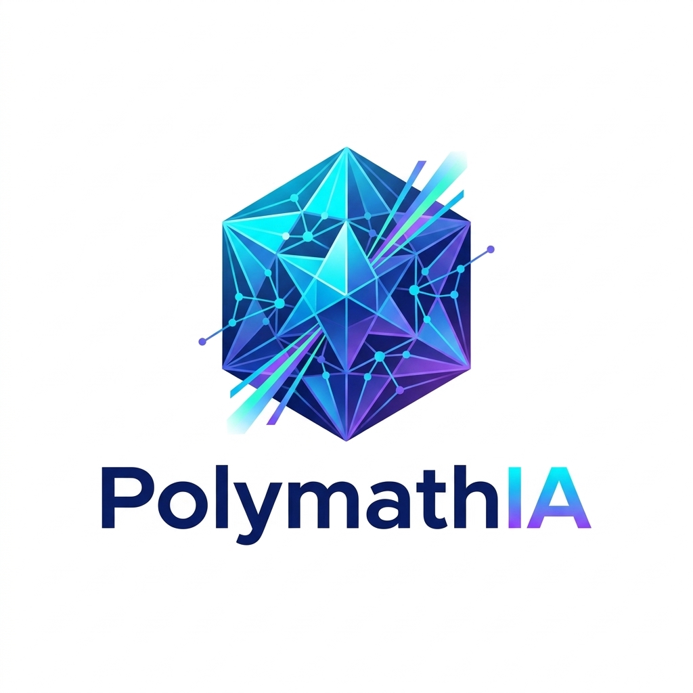

# PolymathIA

Chatbot web qui permettra de discuter avec des modèles d'intelligence artificielle (Mistral, Gemini).
Projet de 2e année de BTS SIO option SLAM (Lycée Léonard de Vinci, Melun), mené en sprints.

**Technologies :** Kotlin, Spring Boot, Spring Data JPA (Hibernate), Thymeleaf, MariaDB, Gradle.

**Présentation détaillée :** [mon portfolio](https://anisloucif.github.io/Pelican-Portfolio/pages/projets-scolaires.html#polymathia)

## Ce qui est fait (Sprint 1)

- Cahier des charges et diagrammes UML : cas d'utilisation, classes, modèle entité-association
- Pages Thymeleaf : accueil (interface du chatbot) et connexion
- Entités `Conversation`, `Message`, `ModeleIA`, `FournisseurIA` et énumération `TypeMessage`, avec leurs relations JPA et leurs DAO
- `DataInitializer` : ajoute les fournisseurs Mistral et Gemini et 4 modèles au démarrage

## À venir

- Comptes utilisateurs, rôles et connexion (Spring Security)
- Envoi des messages aux API Mistral et Gemini

## Lancer le projet

1. Copier `src/main/resources/application-copy.properties` en `application.properties`, puis y mettre les accès à la base et les clés API.
2. Lancer `PolymathIaApplication` dans IntelliJ IDEA.
3. Ouvrir http://localhost:8080
